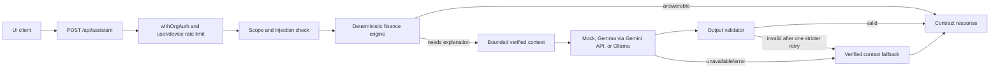

# Finova Open architecture

## Assistant request flow

## Responsibilities

- `src/app/api/assistant/route.ts`: bounded JSON parsing, body validation, demo workspace validation, auth/rate limit wrapper, repository selection, and stable HTTP contract.
- `src/lib/api/withOrgAuth.ts`: optional auth adapter. With `QUIKIT_AUTH_ENABLED=false` and mock repository mode, preserves demo identity; production auth is opt-in.
- `src/lib/assistant/scope.ts`: permissive finance scope check; rejects clear unrelated requests and prompt injection.
- `src/lib/assistant/engine.ts`: deterministic financial answers; sole authority for calculated financial figures.
- `src/lib/assistant/context-builder.ts`: relevant, bounded summaries and figure allowlist from repository data.
- `src/lib/assistant/model-provider.ts`, `model-provider-factory.ts`, `providers/*`: replaceable model interface and provider implementations.
- `src/lib/assistant/validator.ts`: blocks unsupported amounts/percentages, action claims, empty or oversized responses.
- `src/lib/assistant/orchestrator.ts`: deterministic-first routing, provider invocation, one stricter retry, and verified fallback.

## API contract

`POST /api/assistant` request: `{ "message": string, "locale"?: string, "provider"?: "mock" | "gemma-gemini" | "ollama", "workspace"?: Workspace }`. The client workspace is accepted only in unauthenticated mock/demo mode; authenticated or Prisma requests use their authorized repository. Request JSON is limited to 256 KB and demo workspace payloads to 192 KB.

Response remains `{ answer, source, provider, model, contextRefs, validation, latencyMs, limitations }`, where `source` is `verified-data`, `open-weight-model`, or `fallback`; `validation` is `{ passed, issues }`. `GET /api/assistant/health` reports configured provider/model reachability.

## Failure behavior

Missing provider credentials resolve to mock. Scope refusals and deterministic answers do not call a model. A model/provider error returns verified context with a notice; invalid output is retried once with stricter instructions, then falls back to verified context. No model output is treated as authoritative financial data. Logs include request metadata only, never prompts, financial records, credentials, or IP addresses.
